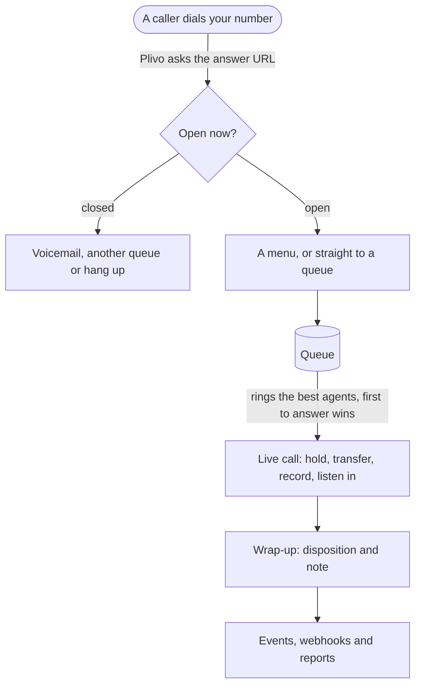

# human-specialist

**Get every call, text and task to the right human. Build your own agent desk on top.**

[](https://github.com/plivo-labs/human-specialist/actions/workflows/ci.yml)
[](LICENSE)
[](pyproject.toml)

human-specialist is an open-source contact-center engine for human agents on Plivo, and it runs on your own servers. It queues calls, SMS, WhatsApp, email, chat, callbacks and tasks, rings the right agents, and runs each conversation through wrap-up. Your desk, dialer and CRM sync use its HTTP API, live event stream, signed webhooks and plugins, or you start with the reference desk in this repository. By [Plivo](https://plivo.com).

[What you need](#what-you-need) · [Deploy](#deploy) · [Quick start](#quick-start) · [What it does](#what-it-does) · [Build your own desk](#build-your-own-desk) · [Docs](#docs)

https://github.com/user-attachments/assets/c624aa17-7604-4e5d-ba02-0f04b19c409e

## What you need

- **A Plivo account.** human-specialist runs on [Plivo](https://plivo.com). You register with the account's Auth ID and Auth Token.
- **A phone number from Plivo.** Calls and texts reach your agents on a number of that Plivo account.
- **A public HTTPS URL.** Plivo sends every call and message to the service, so the internet must reach it. A hosted deploy comes with one. On your own machine, a `cloudflared` quick tunnel gives you one for as long as it runs.

## Deploy

[](https://render.com/deploy?repo=https://github.com/plivo-labs/human-specialist)
[](https://www.heroku.com/deploy?template=https://github.com/plivo-labs/human-specialist)
[](https://deploy.cloud.run/?git_repo=https://github.com/plivo-labs/human-specialist&revision=v1.0.0&dir=deploy/gcp)
[](docs/deploy.md#aws)
[](docs/deploy.md#railway)
[](#quick-start)

A hosted deploy asks for your Plivo account's Auth ID. Once it is up, open its URL and choose **Register**, as [The first run](docs/deploy.md#the-first-run) describes.

| Platform | What it creates | What it needs first |
|---|---|---|
| Render | The service, Postgres and Key Value on Render's free plans | Nothing more |
| Heroku | One app with Postgres and Key-Value Store add-ons | The app's URL in one config var, `PUBLIC_BASE_URL`, after the deploy |
| Google Cloud | Cloud Run, Cloud SQL, Memorystore and the secrets, in a project of their own | The release tag and its public image, which the maintainers publish |
| AWS | Fargate behind CloudFront, with RDS for PostgreSQL and ElastiCache | The CloudFormation template from a release, uploaded in the console or deployed with one command |
| Railway | The service beside Railway's own Postgres and Redis | A Railway template, which does not exist yet |
| Docker Compose | The whole stack and the reference desk on your machine | Docker and a `cloudflared` tunnel |

Each platform's section in [Deploy](docs/deploy.md) says what it sets up, what the paid ones cost, what the free plans leave out, what has run on a live account so far and what to check on a first run.

## Quick start

Run the whole stack on your machine and take a call in your browser. Besides the Plivo account and number, you need Docker with Compose v2, `cloudflared` for the public URL, and a microphone.

> [!IMPORTANT]
> - **Open the UI on `localhost`.** A quick tunnel does not carry the desk's live event stream, and browsers allow the microphone only on `localhost` or HTTPS.
> - **Keys need 32 bytes or more.** `docker/start.sh` generates them. A shorter key you set yourself stops the start.

1. Open a tunnel so Plivo can reach your machine, and leave it running. It prints a URL such as `https://<random-words>.trycloudflare.com`.

   ```sh
   cloudflared tunnel --url http://localhost:6005
   ```

2. Start the stack with that URL. The first run builds the image and takes a few minutes.

   ```sh
   git clone https://github.com/plivo-labs/human-specialist && cd human-specialist
   docker/start.sh https://<random-words>.trycloudflare.com
   ```

3. Open http://localhost:6005 and choose **Register**. Enter your Plivo Auth ID and Auth Token, your email, a password, and the operator key that `grep HS_OPERATOR_KEY docker/.env | cut -d= -f2-` prints. Route your number to the General queue under **Connect**, **Phone Numbers**, pick **Available** in the status menu, and call the number. The call rings on your desk.

The [full quick start](docs/quickstart.md) adds your team, keeps the stack running, and sets up a call with the API alone.

## What it does

- **Seven channels, one queue.** Calls, SMS, WhatsApp, email, chat, callbacks and tasks share queues, skills, capacity and wrap-up.
- **Routing as configuration.** Four queue strategies, teams, skills with levels, sticky agents, overflow, business hours with holidays, keypad menus and voicemail.
- **Call controls.** Hold, warm and cold transfer, two extra participants, recordings you can pause, English transcripts, and supervisors who listen, whisper or barge in. Agents answer in the browser or on a SIP softphone.
- **Wrap-up.** Dispositions and sub-dispositions, a wrap-up timer, and system dispositions for calls nobody answered.
- **Floor, reports and search.** A live floor, [reports](docs/api.md#reports) on conversations and agent activity, and search and [CSV export](docs/api.md#export) over closed conversations, from Postgres or OpenSearch.
- **Events, webhooks and plugins.** Each state change is an event on the [stream](docs/events.md#stream), your [webhooks](docs/events.md#webhooks) and your [plugins](docs/plugins.md). A bot hands a customer over with `POST /queues/{id}/enqueue`, its `context` and its transcript, which the agent sees, and human-specialist never calls a bot.
- **Runs on your servers.** One image with Postgres and Redis. One install serves many organizations, each on its own Plivo account or sub-account. Conversations, messages, reports and transcripts stay in your Postgres.

It has no production agent desk, power dialer, CRM writes, emergency calling, answering-machine detection or AI. [What it does not do](docs/limitations.md) lists each gap.

### How a call flows



Routing ranks the queue's agents by its strategy, teams, skills and capacity, and the first agent to answer gets the caller. A text or a task takes the same path, from queue to offer to wrap-up.

## Build your own desk

The reference desk is optional. It uses only the public API, the event stream and the Plivo Browser SDK, so your own desk can do everything it does. A desk signs the agent in, logs the Plivo Browser SDK in with the session's Plivo access token, sends a heartbeat every 15 seconds, and reads the event stream. [Build your own UI](docs/ui.md#build-your-own-ui) covers each part and points at the reference code.

## Production

The compose stack is for trying things out. In production:

- Run the image on any container platform. A release tag publishes `ghcr.io/plivo-labs/human-specialist:<version>`, and `docker build -t human-specialist .` builds it from a checkout.
- Give it Postgres 14 or later that you back up, and Redis 7 or later set to `maxmemory-policy noeviction`. Run `alembic upgrade head` once before each start and each upgrade.
- Load `HS_OPERATOR_KEY` and `HS_SECRET_KEY` from your secret store, and keep a copy of `HS_SECRET_KEY`. The stored Plivo tokens cannot be decrypted without it.
- Run two or more replicas behind a load balancer that checks `GET /status`. They need no sticky sessions.
- Put a rate limiter at your ingress. Behind a proxy, set `FORWARDED_ALLOW_IPS` to its address, or failed sign-ins from one place lock everyone out for 15 minutes.

One benchmark run held 200 concurrent calls across 10 organizations and 280 agents on two replicas of 1 vCPU each. Answer took 106 ms and accept 119 ms at p99, with no 5xx errors. In a second run, every agent's desk also read its conversation again on each event, as the reference console does, and answer took 167 ms and accept 174 ms. The run used one laptop and the Plivo simulator, so size your deployment for your own traffic with [Capacity](docs/configuration.md#capacity). [Deploy](docs/deploy.md) has the settings for each platform, and [Configuration](docs/configuration.md) lists every variable.

## Docs

| Page | Read it to |
|---|---|
| [Quick start](docs/quickstart.md) | run the stack on your machine and take a first call |
| [Deploy](docs/deploy.md) | run the image on your platform and host the UI |
| [Configuration](docs/configuration.md) | set each variable, size the database, run Redis and fill the search index |
| [API](docs/api.md) | find a route, its auth and its errors |
| [Events and webhooks](docs/events.md) | read the event types, the stream, webhooks and replay |
| [Plugins](docs/plugins.md) | write a plugin and put it on the image |
| [The reference UI](docs/ui.md) | learn its screens, or build your own desk |
| [Architecture](docs/architecture.md) | see how the modules, the data model and the paths fit |
| [What it does not do](docs/limitations.md) | check what is out of scope |
| [Changelog](CHANGELOG.md) | see what changed in each release |

## Contributing

`make check` is the definition of green. [CONTRIBUTING.md](CONTRIBUTING.md) has the setup, the checks, the code rules and the commit conventions, and [AGENTS.md](AGENTS.md) is the short guide for coding assistants. Everyone here follows the [code of conduct](CODE_OF_CONDUCT.md).

## Security

Report a vulnerability as [SECURITY.md](SECURITY.md) describes.

## License

[Apache-2.0](LICENSE)
