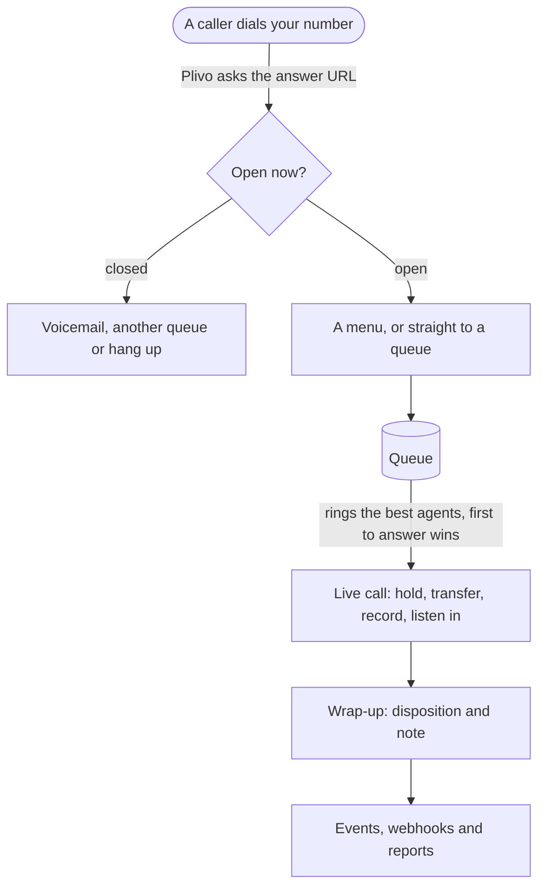
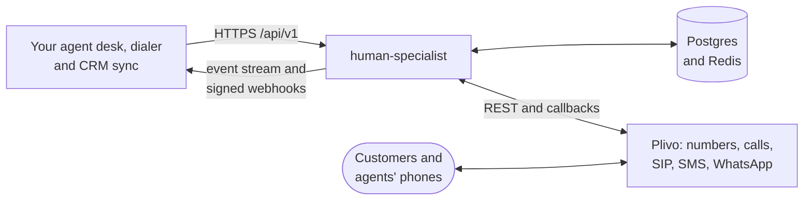

# human-specialist

[](https://github.com/plivo-labs/human-specialist/actions/workflows/ci.yml)
[](LICENSE)
[](pyproject.toml)

**Get every call, text and task to the right human. Build your own agent desk on top.**

human-specialist is an open-source, self-hosted contact-center engine for human agents on Plivo. It queues contacts, routes them, rings your agents and runs the live conversation across calls, SMS, WhatsApp, email, chat, callbacks and tasks. You build your agent desk, dialer and CRM sync on its HTTP API, live event stream, signed webhooks and plugins, or you start with the reference UI in this repo. By [Plivo](https://plivo.com).

[Quick start](#quick-start) · [Use your own UI](#use-your-own-ui) · [Production](#run-it-in-production) · [Docs](#docs) · [Contributing](CONTRIBUTING.md)

## Why human-specialist

A contact center on raw telephony needs the same hard parts every time:

- queues that hold up in a busy hour,
- agent state and capacity,
- offers that ring several agents and give the call to the first one who answers,
- timers for wrap-up and for missed rings,
- a live call you can hold, transfer and listen in on while Plivo's callbacks arrive out of order.

Hosted contact-center suites have these parts, but they own your agent screen and your data. human-specialist is those parts as one service you run, with an API you build on.

It is for:

- Teams building their own agent desk, dialer or CRM integration on Plivo.
- Companies that want their contact center on their own servers, with the data in their own database.
- Products whose bot or phone menu hands a customer to a person. The bot hands over with `POST /queues/{id}/enqueue` and its `context`, and human-specialist never calls a bot.

## What you get

### Every channel, one queue

- Calls, SMS, WhatsApp, email, chat, callbacks and agent tasks share queues, skills, capacity, offers and wrap-up.
- SMS and WhatsApp go out through Plivo or your own gateway. Chat and email go through your gateway.
- WhatsApp messages can use templates, reply buttons and lists. Every conversation keeps notes, attributes and a timeline.

### Routing is configuration, not a drawn flow

- Queues with four strategies: `availability`, `simultaneous`, `fewest_handled` and `least_handle_time`.
- Teams, skills with levels, capacity per channel, sticky agents and overflow.
- Business hours with holidays, keypad menus, a consent notice and voicemail.
- An offer rings several agents at once, and the first to answer gets the call. An agent who lets calls ring out collects strikes and moves to a status you pick.

### Live calls you control with the API

- Hold, warm and cold transfer to an agent, a team, a queue or a number, and up to two extra participants.
- Recordings you can pause and resume, with English transcripts. The audio stays at Plivo and plays through short-lived signed URLs.
- Supervisors listen, whisper or barge in.
- Agents take calls in the browser with the Plivo Browser SDK, or on any SIP softphone.

### Every conversation ends with an outcome

- Dispositions and sub-dispositions, a wrap-up timer and automatic wrap-up.
- System dispositions from each contact's result, so an unanswered call still gets an outcome.
- CSAT scores on the conversation.

### Watch the floor and the numbers

- A live floor of agents, their calls and the callers waiting.
- Reports on conversations by channel, direction, state, disposition and handle time, and on agent activity.
- Search over closed conversations in Postgres, or in OpenSearch at volume. Saved views, and CSV exports of what a search finds.

### An API, a stream, webhooks and plugins

- An HTTP API under `/api/v1`, described at `/openapi.json`.
- A server-sent event stream with replay, and signed webhooks with retries.
- Plugins that receive every event, add routes, or accept your own sign-in.
- Roles for admins, supervisors and agents. Each role sees the whole tenant, its team's work or its own, as you set it.

### Runs on your servers

- One container image, with Postgres and Redis. OpenSearch is optional.
- One install serves many tenants. Each tenant is one Plivo account or sub-account, and its credential scopes every request to it.
- A tenant already on Plivo can keep its own ids, endpoints and Plivo application.
- Conversations, messages, reports and transcripts stay in your Postgres.

## How a call flows



1. Plivo asks human-specialist what to do with the call. The number's entry point checks business hours and runs its action: a menu, a queue, voicemail or a forward.
2. Routing ranks the queue's agents by its strategy, teams, skills and capacity, and rings the best ones. The first to answer gets the caller.
3. Your desk holds, transfers, records or hangs up through the API. A supervisor can listen in.
4. Each agent wraps up with a disposition and a note. Every step is an event on the stream, your webhooks and your plugins.

A text or a task takes the same path. It waits in a queue, rings as an offer, and the agent accepts it.

## Quick start

You will run the whole stack on your machine, register an organization in the reference UI, and take a call in your browser.

The service needs a public HTTPS URL that Plivo can reach, because Plivo sends every call and message to it. On your own machine, a `cloudflared` quick tunnel gives you that URL for as long as it runs. To run the service for real, put it on a server with its own domain, as [Deploy](docs/deploy.md) describes.

### What you need

- Docker with Compose v2.
- A Plivo account with one phone number on it, and your Plivo account's Auth ID and Auth Token.
- `cloudflared`, for the quick tunnel.
- A browser and a microphone.

> [!IMPORTANT]
> Know these two things before you start:
>
> - **Open the UI on `localhost`.** A quick tunnel does not carry server-sent events, the stream the desk runs on. Browsers also allow the microphone only on `localhost` or HTTPS. To open the UI from another machine, run the service on a server with its own domain.
> - **Keys need 32 bytes or more.** `docker/up.sh` generates `HS_OPERATOR_KEY` and `HS_SECRET_KEY` when they are empty. A shorter key you set yourself stops the start.

### 1. Open a tunnel

```sh
cloudflared tunnel --url http://localhost:6005
```

`cloudflared` opens a quick tunnel and prints its URL, such as `https://<random-words>.trycloudflare.com`. Leave it running.

### 2. Start the stack

```sh
git clone https://github.com/plivo-labs/human-specialist && cd human-specialist
docker/up.sh https://<random-words>.trycloudflare.com
```

`docker/up.sh` checks Docker, writes `docker/.env` with fresh keys, builds the image from your checkout, migrates the database, and starts the service, Postgres, Redis and the UI. The first run takes a few minutes. It ends like this:

```text
  ✓ database migrated, service healthy
  ✓ the service reaches Plivo
  ✓ https://<random-words>.trycloudflare.com answers
  ! a quick tunnel cannot carry the desk's live events, so open the UI on this machine

  Open      http://localhost:6005
  Plivo     https://<random-words>.trycloudflare.com   (calls and messages come back here)
  API       http://localhost:6004/api/v1
  Operator  grep HS_OPERATOR_KEY docker/.env | cut -d= -f2-   paste it under Register an organization

  Logs  docker compose -f docker/compose.yaml --profile ui logs -f hs
  Stop  docker compose -f docker/compose.yaml --profile ui down
```

If a step fails, the script stops and prints why.

`docker/up.sh` publishes ports 6004 and 6005. To use others, run `docker/up.sh` once to create `docker/.env`, set `PORT` and `UI_PORT` there, and run it again. A second copy on the same machine also needs its own `COMPOSE_PROJECT_NAME`, or it takes over the first copy's containers and database.

### 3. Register your organization

1. Open http://localhost:6005 on the same machine.
2. Choose **Register an organization**.
3. Enter the operator key, which is the text after `HS_OPERATOR_KEY=` in `docker/.env` (`grep HS_OPERATOR_KEY docker/.env | cut -d= -f2-` prints only the key), a name, and your Plivo account's Auth ID and Auth Token.
4. Press **Register organization**. If the Plivo account is already registered here, the form offers **Make a new organization key**, which signs you in with it.

human-specialist checks the credentials with Plivo and creates a Plivo application that points at your public URL. A Plivo sub-account's Auth ID and Auth Token work the same way, and keep one organization's numbers and usage apart from another's.

### 4. Get started

**Get started** shows the organization's API key once, and the sign-in link for your agents. Copy the key into your password manager. Then enter your name, your email, a password of 8 to 128 characters and your phone number (a number on your Plivo account), and press **Get started**. That one press:

- adds you as an administrator who signs in with that email and password,
- creates a queue named General with you in it,
- routes your number to General,
- lets agents call out with your number as the caller ID,
- adds the wrap-up outcomes Resolved, Follow-up needed and Not resolved, when the organization has none an agent can pick.

Your desk opens at **My Inbox**, with your status and **Call** in the header of every page. From now on, you sign in with your email and password.

### 5. Take your first call

1. Allow the microphone when the browser asks.
2. If the status menu in the header does not read **Available**, pick it.
3. Call your Plivo number from any phone. The call rings on the desk. Press **Accept**.
4. Press **Hold**, then **Unhold**, then **End call**.
5. Choose a disposition and press **Submit**.

That is one whole conversation, from ring to wrap-up. To call out, press **Call** in the header, type the number, and press **Call**.

### 6. Bring in your team

1. Under **Settings**, **Users**, add each agent with their email.
2. In the agent's sheet, press **Set password**, or **Generate password** for one that shows once. Both stay off until the agent has an email.
3. Under **Settings**, **Queues**, add them to General, so its calls ring them too.
4. Hand each agent the sign-in link with their email and password. Their desk renews itself for 12 hours, then asks them to sign in again.

Agents on other machines need the UI on your own domain, as [Host the UI](docs/deploy.md#host-the-ui) describes.

### Keep it running

- **New tunnel URL.** A quick tunnel gets a new URL each time it starts. Run `docker/up.sh https://<new URL>`, then under **Connect**, **Plivo Account**, enter the operator key and press **Re-apply Plivo URLs**.
- **Upgrade.** Pull the new commits and run `docker/up.sh` again. It rebuilds the image from your checkout.
- **No UI.** `docker/up.sh --no-ui https://<public URL>` starts the stack without the UI. The public URL then has to reach port 6004.

<details>
<summary><b>Set up a first call with the API, curl and a SIP softphone</b></summary>

<br>

You also need `jq`. Start the stack with `docker/up.sh` as above, then:

```sh
set -a; . docker/.env; set +a
HS=http://localhost:6004; J='Content-Type: application/json'

# 1. Register the tenant with the operator key. The first tenant key is returned once.
REG=$(curl -sS -X POST $HS/api/v1/tenants -H "Authorization: Bearer $HS_OPERATOR_KEY" -H "$J" \
  -d '{"name":"Demo","plivo_auth_id":"MA...","plivo_auth_token":"..."}')
echo "$REG"   # the tenant and its key, or the error (for example plivo_credentials_rejected)
KEY=$(echo "$REG" | jq -r .api_key)
A="Authorization: Bearer $KEY"

# 2. Create an agent.
AGENT=$(curl -s -X POST $HS/api/v1/agents -H "$A" -H "$J" \
  -d '{"name":"Agent One","external_id":"u-1","role":"agent"}' | jq -r .id)

# 3. Mint SIP credentials and register any SIP softphone with them.
curl -s -X POST $HS/api/v1/agents/$AGENT/sip-credentials -H "$A"

# 4. Set the agent to Available (SIP devices send no heartbeat).
AVAILABLE=$(curl -s $HS/api/v1/agent-statuses -H "$A" | jq -r '.data[] | select(.name=="Available") | .id')
curl -s -X PUT $HS/api/v1/agents/$AGENT/status -H "$A" -H "$J" -d '{"status_id":"'$AVAILABLE'"}'

# 5. Create a queue.
QUEUE=$(curl -s -X POST $HS/api/v1/queues -H "$A" -H "$J" \
  -d '{"name":"Sales","agents":["'$AGENT'"]}' | jq -r .id)

# 6. Route a number on that Plivo account to the queue.
curl -s -X PUT $HS/api/v1/numbers/+14155550100 -H "$A" -H "$J" \
  -d '{"open_action":{"type":"queue","queue_id":"'$QUEUE'"}}'

# 7. Call +14155550100 from any phone. The softphone rings.
#    To dial out, POST /api/v1/calls with {"agent_id": ..., "to": ...}.
```

`PUT /numbers/{number}` points the number at the tenant's Plivo application, so its calls and messages reach the service. Registering the same Plivo account twice answers 409 `tenant_exists`.

</details>

## Use your own UI

The reference UI is optional. It talks to the service only through the public API, the event stream and the Plivo Browser SDK, so your own app can do everything the reference UI does.



| To | Use |
|---|---|
| Configure routing and act on calls, texts and wrap-up | The [HTTP API](docs/api.md) under `/api/v1` |
| Show what happens, live, on a desk or a wallboard | The [event stream](docs/events.md#stream), `GET /api/v1/events/stream` |
| Keep your CRM or warehouse in sync from your server | [Signed webhooks](docs/events.md#webhooks), with retries and [replay](docs/events.md#replay) |
| Run your own code inside the service: your SSO, an event sink, extra routes | [Plugins](docs/plugins.md) |

Watch your organization live. Set `KEY` to the organization API key from **Get started**, then run:

```sh
curl -N http://localhost:6004/api/v1/events/stream -H "Authorization: Bearer $KEY"
```

Call your number, and the events arrive as the call moves (trimmed here):

```text
retry: 3000
: ping

id: 42
data: {"id":"42","type":"offer.created",…,"direction":"inbound",…,"data":{"to":"+14155550100","via":"queue","from":"+14155550123","channel":"call",…}}
```

To build a desk of your own:

- **Sign agents in.** Your server mints a session with `POST /api/v1/agents/{id}/sessions`, or the agent signs in with an email and password at `POST /api/v1/sessions`. The desk renews the session with `POST /api/v1/me/sessions` for up to 12 hours.
- **Ring the browser.** Log the Plivo Browser SDK in with the session's Plivo access token.
- **Keep the agent online.** Send `POST /api/v1/me/heartbeat` every 15 seconds from a Web Worker. An agent silent for 40 seconds goes Offline.
- **Stay live.** Read the stream with the session's stream token. After a drop, resume with `Last-Event-ID`.

[Build your own UI](docs/ui.md#build-your-own-ui) points at the reference desk's code for each of these, and [Auth](docs/api.md#auth) covers sessions, passwords and keys.

## Run it in production

The compose stack in `docker/` is for trying things out. Its Postgres runs in a container with a fixed password. For production:

- Run the image `ghcr.io/plivo-labs/human-specialist:<version>` on any container platform, such as ECS or Fargate, Kubernetes or Cloud Run. A release tag publishes it; until the first one, build it from your checkout with `docker build -f docker/Dockerfile -t human-specialist .`.
- Point `DATABASE_URL` at a Postgres 14 or later that you back up, and `REDIS_URL` at Redis 7 or later set to `maxmemory-policy noeviction`.
- Load `HS_OPERATOR_KEY` and `HS_SECRET_KEY` from your secret store. Keep a copy of `HS_SECRET_KEY`, because the stored Plivo tokens cannot be decrypted without it.
- Run the migrations once before each start and each upgrade:

  ```sh
  docker run --rm --env-file docker/.env ghcr.io/plivo-labs/human-specialist:<version> alembic upgrade head
  ```

- Run two or more replicas behind a load balancer, with the health check on `GET /status`. They share Postgres and Redis and need no sticky sessions. [Size the database connections](docs/configuration.md#size-the-database-connections) for the replica count.
- Put a rate limiter at your ingress. The API does not limit request rates.
- Behind a proxy or load balancer, set `FORWARDED_ALLOW_IPS` to its address. Otherwise the sign-in limit counts every client as the proxy, and failed sign-ins from one place lock everyone out for 15 minutes.

[Deploy](docs/deploy.md) has the settings for each platform, and [Configuration](docs/configuration.md) lists every variable.

### How much it holds

One benchmark run held 200 concurrent calls across 10 tenants and 280 agents, on two replicas with 1 vCPU each. Answer took 106 ms and accept 119 ms at p99, with no 5xx errors, no retries and no deadlocks. The run was on one laptop against the Plivo simulator, with no real carrier latency, so size your deployment for your own traffic. [Capacity](docs/configuration.md#capacity) has every number and the two limits outside that run.

## What it does not do

human-specialist ships no production agent desk, no power dialer and no CRM writes. It has no emergency calling, no answering-machine detection and no AI. [What it does not do](docs/limitations.md) lists each gap, and where you can build it on the API.

## Docs

| Page | Read it to |
|---|---|
| [Deploy](docs/deploy.md) | run the image on your platform and host the UI |
| [Configuration](docs/configuration.md) | set each variable, size the database, run Redis and fill the search index |
| [API](docs/api.md) | find a route, its auth and its errors |
| [Events and webhooks](docs/events.md) | read the event types, the stream, webhooks and replay |
| [Plugins](docs/plugins.md) | write a plugin and put it on the image |
| [The reference UI](docs/ui.md) | learn its screens, or build your own desk |
| [Architecture](docs/architecture.md) | see how the modules, the data model and the paths fit |
| [What it does not do](docs/limitations.md) | check what is out of scope |
| [Changelog](CHANGELOG.md) | see what changed in each release |

## Contributing

```sh
uv sync
docker compose -f docker/compose.test.yaml up -d   # Postgres and OpenSearch for the tests
make check                                         # lint, format, unit, contract, migration and acceptance tests
```

The tests start their own Redis, so put `redis-server` and `redis-cli` from Redis 7 or later on your `PATH` (`brew install redis`, or `apt-get install redis-server tzdata-legacy` on Ubuntu 24.04 or later). [CONTRIBUTING.md](CONTRIBUTING.md) has the checks, the code rules and the commit conventions. Report a vulnerability as [SECURITY.md](SECURITY.md) describes, and follow the [code of conduct](CODE_OF_CONDUCT.md).

## License

[Apache-2.0](LICENSE)
