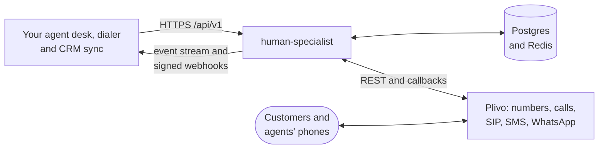

# The reference UI

`ui/` is an optional browser UI for human-specialist: a React app built with Vite, TypeScript and Tailwind CSS. It talks to HS only through the public API, the event stream and the Plivo Browser SDK, so your own UI can do everything it does in the same way. Run it as it is, copy parts of it, or leave it out. HS runs the same without it.

The HS image serves it at `/`. To host it apart from HS, see [Deploy](deploy.md#host-the-ui).

## Screens

The app routes by path (`/desk`) and runs at the root of its origin: its routes, its assets and `config.js` are root-relative, so it cannot be hosted under a sub-path. The server that hosts it answers the paths of its screens with `index.html`, so a link to a screen opens it, and a missing file with 404. HS and the `ui` image's proxy do, and `npm run dev` answers every path. A link made before, such as `/#/signin?org=<id>`, still opens its screen.

A sidebar lists the screens the browser's credentials open: **My Inbox** with a session, the floor when that person is a supervisor or admin, and setup with an admin's session or the organization key. With a session, the header shows the agent's status menu, the dialer and **Message** on every page, and a call or text offer rings on any page; a conversation that connects or reaches wrap-up opens in **My Inbox**. The header also holds the theme switch and the account menu, which names the signed-in user and their email. Setup screens are lists with a search box; a row opens its form in a side sheet.

| Route | Who uses it | What it does |
|---|---|---|
| `/signin` | anyone | Signs a person in with email and password, taking the organization ID from a sign-in link (`/signin?org=<id>`). Its **API key** tab signs in with an organization key. **Register** takes the Plivo account's Auth ID and Auth Token, your email and a password. It first signs out any session this tab holds, then calls `POST /tenants` with no name, so the organization takes the Plivo account's name. With the organization key that returns, it adds you as an admin named after your email, who signs in with that email and password, a queue named General with you in it (default strategy), and the dispositions Resolved, Follow-up needed and Not resolved when the organization has none an agent can pick. Then it opens your desk, where a panel shows the organization key once, to copy, and the email you sign in with, as HS stored it. Its **Add a phone number** opens **Phone Numbers**, and **Done** closes it. The organization key, the Plivo token and the password stay in the page's memory and are never stored in the browser; the page holds only your session once you are in. A failure names its step. When the organization exists but a later step failed, the form says so, its fields freeze, and **Try again** reruns the steps with the key, the email and the password still in memory, needing no operator key. Each step looks up what exists first, so a retry adds no second administrator, queue or outcome, and a second press while one runs registers nothing twice. When the request that creates the organization gets no answer, the form says the organization may have been created and that **Make a new organization key** finishes it. The form also has an **Operator key** field (`HS_OPERATOR_KEY`), unless `GET /status` answers `"setup": true`: that server registers its first organization without the key. A request without the key that answers 401 shows the field too, and the next press sends it. A Plivo account already registered answers 409 `tenant_exists` with its `tenant_id`, and the form says that a setup which stopped partway, its page closed, is finished by making a new organization key. **Make a new organization key** mints a key with every scope through `POST /tenants/{id}/api-keys` using the operator key, shows it once and opens **Who are you?** with it. |
| `/you` | an organization key holder | **Who are you?** Pick an admin or supervisor, or add yourself as an admin by name, email and password, so you sign in without the key too. When an admin already has that email, the form says so and changes its button to **Set a new password for <email>**: that second press sets the account's password, ending its other sessions, and signs you in as it. It mints that user's session, and from then on the browser holds that session, not the key. **Not now** keeps the key alone; **Take calls** in the header comes back here. |
| `/tasks` | an admin | Lists tasks, with **Refresh**. A task's sheet changes its name, priority and status; a resolved or cancelled task opens read-only. |
| `/conversations` | an admin | Lists conversations, with **Refresh**. Each one shows its number (`#1000000000`), timeline with a text's messages, the bot's turns before the handoff above it, wrap-up with each agent's note, handoff context and recording playback; a recording whose signed URL expired fetches a fresh one when played. |
| `/teams`, `/skills` | an admin | Adds, renames and deletes teams and skills. A team name another team has asks before it saves. |
| `/queues` | an admin | Adds queues, picks their members, disables or enables them, and deletes them. A queue's sheet names the numbers, menus and queues that route to it, and disabling it then asks again. A queue that conversations wait in, or that tasks are scheduled for, is not deleted: the error says how many wait, and to disable the queue and delete it once they are taken or closed, and how many are scheduled, and to give them another target or cancel them. A disabled queue is marked in the number pickers and offered only where already chosen. The sheet also sets how long a contact waits on each channel before the queue gives up: a call's `wait_timeout_sec`, 20 seconds unless changed, and each other channel's `text.wait_timeout_sec`, no time limit unless set. It picks the queue's agents and teams, and its skill rules, each a skill, a rule and a level, and the table lists a queue's teams and skills beside its agents. A save sends only what the sheet changed, so a queue's teams and rules made through the API stay when the sheet renames it, and an agent, team or skill deleted while the sheet was open is refused on its own field. |
| `/statuses` | an admin | Adds, edits and orders the statuses agents pick. Drag a row by its handle, or focus the handle and press the up or down arrow. Its **Configurations** tab sets the status on sign-in, on sign-out and when idle. |
| `/contacts` | an admin | Adds the saved numbers agents transfer calls to (`/transfer-destinations`). A contact made with a URL through the API lists and edits its URL here. |
| `/outbound` | an admin | Sets the default caller ID and senders, whether agents may dial out, and which calls record. |
| `/hours` | an admin | Adds business hours with their open hours and time zone, and holiday lists. Business hours that use a holiday list close on the holidays checked in their sheet (`selected_holidays`); a list picked anew starts with all of them checked, and a holiday added to the list later starts unchecked. |
| `/workload` | an admin | Sets how long an offer rings on each channel, how many conversations an agent holds on each, and whether wrap-up holds a slot. |
| `/dispositions` | an admin | Sets text timeouts and the wrap-up timer. Its **Dispositions** tab adds, edits, orders and turns off the outcomes agents pick at wrap-up, with their sub-dispositions. |
| `/agents` | an admin | Adds and lists users, with **Refresh**, under the organization's sign-in link. A name another user has asks before it saves. A user's sheet edits their name, role, email, teams, skills and caller ID, deletes them, sets or generates their password (both stay off until the user has a saved email; a password set for the signed-in person says it ends their session and then returns to sign-in with the reason), signs them out everywhere, and resets the SIP password. The caller ID is picked from the Plivo account's numbers, routed ones first; one not routed yet is routed on save (`PUT /numbers/{number}`) to a queue the user answers, else the first enabled queue, and the sheet says so before saving. If the user's save then fails, it says the number stays routed, and the next save saves only the user. When the account's numbers do not load, the field takes a typed number and offers **Try again**, as **Add number** does. An email another user has is refused on the email field. Each checked skill that takes a level needs one inside the skill's range, refused on its field otherwise, and the list shows each user's skills. |
| `/numbers` | an admin | Adds numbers, picked from the Plivo account's numbers (`GET /numbers/available`) or typed, and routes each one to a queue. A number's sheet also sets its business hours and what callers get when closed: hang up, a voicemail to the open queue, or another queue. Every save is a `PUT /numbers/{number}` of the number's current entry point with only what you changed, so a re-route keeps the hours. Adding a number already listed says where it goes now and asks before moving it. The sheet also deletes the number. |
| `/plivo` | an admin | Re-applies the organization's Plivo URLs (`PATCH /tenants/{id}` with `{}`) after `PUBLIC_BASE_URL` changes. |
| `/desk` | an agent session | **My Inbox**: incoming calls and texts, the softphone, mute, hold, a keypad, recording, warm and cold transfer, hang-up, a text's thread and replies, wrap-up and each conversation's activity. `/desk/{id}` opens one conversation the agent holds. |
| `/floor` | a supervisor or admin session | Agents and their calls, waiting callers, and listen, coach and barge-in. |

Every action shows that it started, then that it worked or why it did not, with the API's `error.message` and code. A 422 also names each field in `details.fields` and its reason. Deleting and signing a user out everywhere ask for a second press in the sheet. When the organization key stops working (401), the UI drops it and returns to sign-in with the reason, unless a session is open. When the session stops working, the UI returns to sign-in with the reason.

## Sign-in and sessions

- The UI says organization for what the API calls a tenant: one company, with its own Plivo account and API key. The API, its routes and its settings keep the word tenant. Each organization sees only its own data, and inside it the user's role decides what shows.
- People sign in with their email and password on the first tab of `/signin` (`POST /sessions`). An admin gives each user an email in their sheet, then sets a password there or generates one, which shows once. A server with one organization needs nothing more. On a server with more, each organization hands out its sign-in link, `/signin?org=<organization ID>`, and the page sends that ID as `tenant_id`; without it, the page says to open that link. Too many failed tries say how long to wait. **Users** shows the link.
- A person who signs in holds only their own session. An agent sees **My Inbox**, a supervisor also the floor, and an admin also Conversations, Tasks, Settings and Connect, which run on the admin's session with no organization key in the browser. Signing a user out everywhere (`DELETE /agents/{id}/sessions`) needs the organization key, so the sheet offers it only while the browser holds one; a new password also ends every session of the user.
- The organization key keeps its tab for the first setup and for integrators. It needs the `admin` and `sessions` scopes, as the key from registration has. After it signs in, **Who are you?** mints your own session with `POST /agents/{id}/sessions`, and the browser holds both: setup calls use the key, and desk calls use the session.
- Every desk renews its session with `POST /me/sessions`, however it signed in: six minutes before the session's hour ends, and again each minute if that fails. The API calls, the heartbeat and the event stream move to the new tokens at once; the stream resumes after the last event it saw (`?after=`). The softphone signs in with the new Plivo token once no call rings, dials or is live, so a renewal never cuts a call. Renewals go on for 12 hours from the sign-in. Then HS answers 403 `sign_in_required`: the desk stops renewing, warns five minutes before the session ends, and the person signs in again.
- A session also ends when an admin signs the user out everywhere, sets their password, changes their role or deletes them. The next request answers 401, and the UI reloads to sign-in with the reason, so no softphone of the ended session stays signed in.
- **Change password** in the account menu sends `PUT /me/password`. It ends every session of the person, this one too, so the UI returns to sign-in for the new password. **Sign out** sends `DELETE /me/sessions` and clears the browser's key and session.
- The operator key typed on **Plivo Account** or **Register** is used for its request and kept nowhere. A user with no password cannot renew an older session or sign in, and the desk says to ask an administrator for one under Settings, Users. A company's own app can mint a session on its server and hand it to the browser in the URL fragment, `#session=<the session's JSON in base64>`, which the browser never sends to a server. The desk renews it as above.
- Keys and tokens live in `sessionStorage`. They end with the tab, and other tabs do not see them. A registration's organization key is the exception: it lives only in the page's memory until the panel closes or the page reloads.

## How the desk works

- The softphone is Plivo's Browser SDK, `plivo-browser-sdk` from npm at one pinned version, loaded when the desk opens. It needs a secure context: HTTPS, or `localhost`.
- When the desk opens, it reads the microphone permission. It asks for the microphone only while the browser has not decided, then stops the tracks, so a granted microphone stays off until a call. A browser without the Permissions API keeps a note in `localStorage` after the first grant, so it is not asked again on that device. If the browser blocks the microphone, the desk says so and does not sign the phone in.
- While a desk session lives, HS rings the agent in this browser, not on a SIP phone.
- The desk sends `POST /me/heartbeat` every 15 seconds from a Web Worker, because a hidden tab slows the page's own timers to once a minute, past HS's 40-second limit.
- It reads events from `GET /events/stream` with `fetch`, the session's stream token in the `Authorization` header, so the token stays out of URLs and access logs. HS sends a frame at once and a ping at least every 15 seconds. After 35 seconds without a byte, the desk says that live updates stopped and reconnects after the last event it saw (`?after=`); once frames flow again, it rereads the call and **My Conversations**.
- It reads `GET /conversations/{id}` for where the agent stands on each conversation it holds. If that read fails, the desk says so and marks the conversation on screen as possibly out of date. On reload, it reads every conversation the agent holds with `GET /conversations?participant_agent_id=`, and the text offers still open from `pending_offers` in `GET /me`. The first time it holds a conversation, it reads that conversation's events with `GET /conversations/{id}/timeline`, following `next_cursor` for at most ten reads while it still holds the conversation, so the activity shows what happened before a reload; live events then add to it, each once. Ten reads give up to 2,000 of the events the agent may see, fewer when many are hidden from it, and a longer conversation is cut there. Of what it read and what arrives live, the activity keeps the newest 100 events of all the agent's conversations; messages and notes come from their own reads. A read that fails for the network or a 5xx is tried again at the conversation's next load; a refusal is final, and a conversation the agent is only offered is not read.
- **My Conversations** lists the offers ringing and the conversations the agent holds, wrap-up included, read with `GET /conversations?participant_agent_id=` when the desk opens, when live updates resume, and on **Refresh**. Past conversations are on the Conversations screen.
- Each call, text, task or callback the agent holds is a line in **My Conversations**, with its channel and state, and a text in the background shows how many new messages it has. The line on screen is marked, and picking another opens it at `/desk/{id}`. A line that connects or reaches wrap-up takes the screen. The call card stays in view whichever line is open. The agent holds as many calls, texts and tasks at once as their capacities allow; HS decides what it offers.
- A text (SMS, WhatsApp, chat or email), task or callback offer shows in the same card as a call: the customer or the task's title, a text's latest message (`last_message` in `GET /conversations/{id}`), how long the customer has waited and the time left. **Accept** and **Decline** call `POST /offers/{id}/accept` and `POST /offers/{id}/decline`. Each offer has its own card. On **My Inbox**, on a screen at least 768 pixels wide, the offer cards and the call card sit at the top of **My Conversations** and push down only its list, so the open conversation and its details keep their height. The list keeps room for two lines; cards that need more scroll there. On other pages, and on a narrower screen, they sit in a strip above the page. No card covers the open conversation.
- A text's thread reads every page of `GET /conversations/{id}/messages`, and reads it again whenever the stream brings a `message.*` event for it, so customer messages and delivery statuses show live. The customer's messages sit on the left, the agent's on the right with their delivery status, and the conversation's events between them.
- The reply box sends `POST /conversations/{id}/messages`. Enter sends, and Shift+Enter adds a line. On WhatsApp the box takes a free reply only within 24 hours of the customer's last message; past that it says WhatsApp needs an approved template, which the desk does not send. An email reply goes under the customer's last subject, with `Re:` in front.
- **End conversation** calls `POST /conversations/{id}/close`, which opens the agent's wrap-up. A text's wrap-up is the same form as a call's.
- A call's screen shows its events and, below them, a note box built like the reply box: **Add note** sends `POST /conversations/{id}/notes`. Notes show among the events of any line, in the wrap-up form and on the conversation's page under Conversations. The customer never sees them.
- A task's or callback's line shows its description, priority and due date. **Resolve** sets the task's status to resolved (`PATCH /tasks/{id}`), which opens the same wrap-up. When the task names a customer, as a callback does, the line offers **Call**: `POST /calls` with the line's `conversation_id`, so the call joins the task's conversation and ends without closing it. Its card has mute, hold, the recording control and end, as any call's does, but no transfer, which HS refuses on such a call. End leaves the line open, and **Resolve** while the call is on ends the call too. Calling needs `agent_direct_dial`, as **Call** in the header does.
- HS names each ring in its SIP headers. The desk answers the agent's own dial-out and a supervisor's monitor leg at once, and shows the rest as offers to accept or reject.
- **Call** in the header dials out with `POST /calls` only while the organization's `agent_direct_dial` setting is on (`PATCH /settings`). While it is off, **Call** stays visible, and pressing it says that calling out is off and where an admin turns it on. A settings save renews the session at once, because the Plivo token carries `agent_direct_dial` from when it was minted. Its window also lists the last five numbers the agent called (`GET /conversations?agent_id=&direction=outbound&channel=call`), newest first, each named when an internal contact has its number (`GET /transfer-destinations`), and pressing one calls it again. A dial shows as dialing, then ringing until the customer answers, then live. A dial that fails shows the reason.
- **Message** in the header starts an SMS or a WhatsApp conversation with `POST /conversations`, from the organization's `default_from` for the channel. Like **Call**, it needs `agent_direct_dial`, and it needs a status that takes conversations, since HS refuses a start from an agent who is not available (409 `agent_unavailable`). An SMS starts with the text the agent types. A WhatsApp starts with an approved template (`GET /whatsapp/templates?status=approved`). While the list loads, has none or could not be read, the window says so, with **Try again** for a list that failed. A pick lasts while the window is open on WhatsApp, so a reopened window starts without one. The window asks for each of the template's variables: a placeholder in a text header or the body, a media header's URL, and a placeholder in a link button. HS takes no template with a variable left out, so **Send** stays off until a template is picked and each of its variables is filled. It does not ask for a location header, so HS refuses such a template (422 `invalid_template`). Only HS knows the agent's free slots, so a full channel shows after **Send** as HS's 409 `agent_at_capacity`. Any refusal shows HS's reason, and the window keeps what was typed. The new conversation opens on the desk. On a screen narrower than 640 pixels, **Call** and **Message** show as icons.
- Transfer lists come from `GET /transfer-targets?channel=call`, in three tabs: agents who can take a call first, teams with how many agents are free, and saved contacts or a typed number. An agent who cannot take a call is dimmed and cannot be picked. A number transfer also needs `agent_direct_dial`.
- The desk offers **Pause rec** when `settings.recording` in `GET /me` says the call's direction records and `allow_pause` is on. An HS whose `/me` has no `settings.recording` gets no recording control. A pause made anywhere shows on the call.
- **Keypad** and **Mute** on a live call's card show while this browser's phone holds the call it answered for that card's conversation, so not after a reload in the middle of a call, for a call answered elsewhere, or on a card beside the answered call. **Keypad** opens the twelve keys of a phone (1 to 9, `*`, 0 and `#`), as an IVR asks for them. Each key, or the same key typed while the keypad is open and no field has focus, hands its digit to the Plivo Browser SDK's `sendDtmf` on the agent's leg, and the card shows the last keys pressed ("Pressed 1 * 2"). `sendDtmf` reports neither delivery nor failure, so that line is what the agent pressed, not proof that a tone arrived. A key pressed while the browser is offline, its phone has lost its connection to Plivo, or the call is gone is not sent and not shown on that line, and the desk says so. HS seats each agent in the call's room with Plivo's DTMF relay on (`relay_dtmf_inputs`). The keypad stays open while the caller is on hold.
- Wrap-up picks a disposition, then a sub-disposition when it has some, from lists.
- At the top of the open conversation, on every channel, **Before the handoff** shows the bot's turns (`transcript` in `GET /conversations/{id}`), each with Bot or Customer and its time when it has one, once the agent may read the handoff context. Without a transcript nothing shows.
- Beside the conversation, the desk shows the customer's details, the handoff `context` once the agent is on the conversation, and the customer's last five conversations the agent can see (`GET /conversations?number=&sort=last_activity_at`).
- **Create task**, under **Actions** at the top of that column and there with or without a conversation open, sends `POST /tasks` from a sheet: the task type, a follow-up's channel and schedule, the title and description, a callback's customer number, whom it is assigned to (you, an agent or a team from `GET /transfer-targets?channel=task`), the priority and an optional due date, which a follow-up takes from its schedule. Raised from an open conversation it carries that `conversation_id`, so a callback takes its customer; if that conversation closes first, HS refuses it once and the next **Create task** raises it from none, with what was typed kept. **Tasks**, under the customer's details, lists the tasks raised from that conversation (`GET /tasks?conversation_id=`, read again on each `task.*` event for it); the task also reaches its agent's desk and the admin's Tasks list.

## Run it while you change it

`npm run dev` serves the app with hot reload and passes `/api/`, `/plivo/`, `/status` and `/openapi.json` to HS. Use the Node version in `ui/.nvmrc`.

```sh
cd ui
npm ci
HS_URL=http://127.0.0.1:6004 npm run dev
```

Before you open a pull request, run `npx tsc --noEmit`, `npm test` and `npm run build`, as CI does. Every API call in `ui/src` must use a literal `/api/v1/...` path, so that `tests/contract/test_ui_routes.py` can check it against the route table.

## Build your own UI

Your own desk, dialer or CRM sync talks to HS the way the reference UI does.



| To | Use |
|---|---|
| Configure routing and act on calls, texts and wrap-up | The [HTTP API](api.md) under `/api/v1` |
| Show what happens, live, on a desk or a wallboard | The [event stream](events.md#stream), `GET /api/v1/events/stream` |
| Keep your CRM or warehouse in sync from your server | [Signed webhooks](events.md#webhooks), with retries and [replay](events.md#replay) |
| Run your own code inside the service: your SSO, an event sink, extra routes | [Plugins](plugins.md) |

A desk of your own does four things:

- **Sign agents in.** Your server mints a session with `POST /api/v1/agents/{id}/sessions`, or the agent signs in with an email and password at `POST /api/v1/sessions`. The desk renews the session with `POST /api/v1/me/sessions` for up to 12 hours.
- **Ring the browser.** Log the Plivo Browser SDK in with the session's Plivo access token.
- **Keep the agent online.** Send `POST /api/v1/me/heartbeat` every 15 seconds from a Web Worker. An available agent silent for 40 seconds takes the sign-out status (Offline, unless the **Configurations** tab of **Statuses** names another or switches it off), and the second heartbeat after the desk comes back signs it in again. An agent on Break keeps Break through the silence and when the same session comes back; a new session signs it in. [Auth](api.md#auth) has the whole heartbeat rule, the 2-hour bound included.
- **Stay live.** Read the stream with the session's stream token. After a drop, resume with `Last-Event-ID`.

[Auth](api.md#auth) covers sessions, passwords and keys.

The app is a reference, not a framework. The screens live in `ui/src`, grouped by area (`setup/` and `desk/`), and each call they make is a literal path, so you can read off the calls your own UI needs. Start with `ui/src/desk/desk.tsx` for the session, the stream and the heartbeat, and `ui/src/desk/state.ts` for how events and conversation reads become what the agent sees.

## Settings

| Setting | Default | What it sets |
|---|---|---|
| `window.HS_URL` in `config.js` | `""` | The HS base URL. Empty means HS on the UI's own origin. `config.js` sits beside `index.html` in the build, so you change it without a rebuild. |
| `CORS_ALLOWED_ORIGINS` (HS) | empty | Must list the UI's origin when `config.js` names another origin. |
| `UI_PORT` (compose) | `6005` | The host port of the `ui` service. |
| `HS_UPSTREAM` (compose) | `hs:6004` | The HS address the `ui` service proxies to. |
| `HS_URL` (`npm run dev`) | `http://127.0.0.1:6004` | The HS address the dev server proxies to. |

## Limits

- Reports and search have no screen yet. On the desk, an agent cannot start an email, send a WhatsApp template in a conversation already open, a file or an email's cc, transfer a text or a task, or mark a text waiting. The API serves all of these.
- A queue's strategy shows read-only, and its overflow has no screen. The API serves both.
- Search boxes filter the rows already loaded, ignoring spaces, `+`, `#`, dashes and parentheses. Load more rows to search further; `/conversations/search` searches closed conversations through the API.
- The desk transfers to agents, teams, saved contacts and numbers, not to a queue, because an agent token cannot list queues.
- The floor shows the waiting callers of each queue by name beside the total.
- While a call rings, the call card shows what the offer event carries (the caller and the number they called, or the conversation's own address when the event has none) and, for an inbound call, how long the caller has waited, read with `GET /conversations/{id}`. An agent cannot read a conversation's handoff `context` until it accepts, so the card shows none while it rings. Each offer has its own card, and My Conversations lists them all.
- Saved views, exports, extra conversation filters and the call session timeout have no screen: the UI is a reference kept to 5,000 lines of `ui/src` app code, tests excluded, not because HS lacks them. Your own UI uses `/views` (and `/views/{id}/conversations`), `POST /conversations/export` and `/conversations/export/content`, the `/conversations/search` filters, and `call_session_timeout_sec` in `/settings`.
- IVR menus and the organization's settings beyond the screens above have no screen. Set them through the API.
- The header names the organization only when this browser re-applied its Plivo URLs, because an organization key cannot read the organization's name.
- Lists page through what the API returned so far. Where the API pages by cursor, the count reads `1-20 of 20+` until the last page loads.
